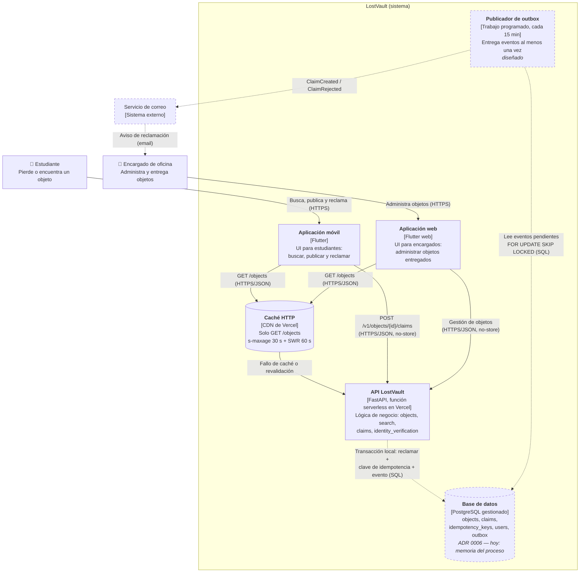

# C4 nivel 2 — Contenedores de LostVault

Diagrama como código (Mermaid, se ve directamente en GitHub). Es la versión
única del C4 nivel 2: reúne lo que ya mostraba el diagrama anterior (`C4 nivel
2.jpg`, retirado en S12) —dos interfaces, el encargado administrando objetos
desde la web y las notificaciones— y le agrega la estrategia de datos de la S12:
caché, base de datos según el ADR 0006 y el publicador de eventos.

Cada almacén de datos y el mecanismo de mensajería aparecen como **contenedores
propios**. Línea continua = existe hoy; línea punteada = decidido en un ADR,
pendiente de implementar.

| Contenedor | Tecnología | Estado | Decisión |
|---|---|---|---|
| Aplicación móvil | Flutter | Corre en local; adaptadores in-memory | [ADR 0001](../adr/0001-estilo-arquitectonico.md) |
| Aplicación web | Flutter web (mismo código base) | Corre en local (`flutter run -d chrome`); no publicada | [ADR 0001](../adr/0001-estilo-arquitectonico.md), [arc42 §7](../arc42/07_vista_despliegue.md) |
| Caché HTTP | CDN de Vercel (cabeceras `Cache-Control`) | Implementado en `backend/main.py` | [cache.md](../datos/cache.md) |
| API LostVault | FastAPI en Vercel | Desplegado | [ADR 0002](../adr/0002-integracion-reclamacion-api.md), [ADR 0003](../adr/0003-plataforma-despliegue-vercel.md) |
| Base de datos | PostgreSQL gestionado | Decidido, pendiente | [ADR 0006](../adr/0006-postgresql-fuente-de-verdad.md) |
| Publicador de outbox | Trabajo programado (GitHub Actions `schedule:` o Vercel Cron) | Diseñado | [eventos.md](../datos/eventos.md) |

Notas:

- Las dos aplicaciones comparten el mismo código Flutter; se muestran separadas
  porque atienden a usuarios y funciones distintas.
- Los endpoints de gestión de objetos para el encargado aún no existen en la API;
  hoy solo están `GET /objects` y la reclamación.
- **`api/` no es un contenedor.** Es una segunda implementación de la
  reclamación (FastAPI, `api/app/`) que no está desplegada ni se ejecuta en CI;
  el contenedor "API LostVault" corresponde a `backend/`. Si el equipo decide
  desplegar `api/`, debe aparecer aquí como contenedor propio. Ver R10 en
  [arc42 §11](../arc42/11_riesgos.md).
